# Hi, I'm Shi Hui 👋

 

---

### ✦ About Me

I am a developer driven by curiosity and a passion for crafting clean, efficient applications. I enjoy exploring new technologies, solving complex challenges, and building software that delivers a great user experience.

- 🔭 **Current Focus:** Modern web applications, scalable architectures & robust APIs
- 🌱 **Learning:** Cloud architecture & distributed systems
- 💬 **Ask me about:** JavaScript, TypeScript, Python & full-stack development
- ⚡ **Interests:** Clean code, UI/UX design, and open-source collaboration

---

### ✦ Tech & Tools

---

### ✦ Contribution Garden 🌸

<picture>
  <source media="(prefers-color-scheme: dark)" srcset="https://raw.githubusercontent.com/shuiii129/shuiii129/output/contribution-garden-dark.svg" />
  <source media="(prefers-color-scheme: light)" srcset="https://raw.githubusercontent.com/shuiii129/shuiii129/output/contribution-garden.svg" />
  
</picture>

---

  Designed with simplicity and focus • © Shi Hui

